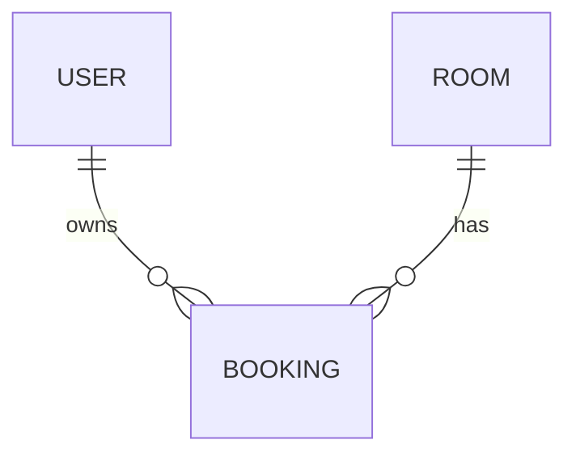

# Phase 1: Problem Framing

## 1. Problem statement

Answer in two or three sentences:

- Who experiences the problem?
- What are they trying to accomplish?
- What difficulty exists today?
- Why is solving it useful?

**Draft:**

Internal meeting-room booking for one organisation.

## 2. Goal

Describe the outcome the system should enable. Avoid describing a technical
solution.

**Draft:**

Employees need simple way to find available meeting rooms 
and reserve them for specific time. 
The system must prevent conflicting bookings and allow employees to view, edit and cancel their reservations.
Administrators need to maintain room information, manage room availability.

## 3. Actors

For each actor, describe their responsibility and what they need from the
system.

| Actor | Responsibility | Main need |
| Employee | View rooms & add/manage their own bookings | --- |
| Administrator | Has all employees roles & manages rooms and all bookings |  |

## 4. Main use cases

Write short user-focused actions, for example: “View available resources.”

1. View rooms and availability for selected date and time range
2. Booking a space for one person or group of people (select date&time -> system confirms booking)
3. View & cancel own booking
4. Admin - create rooms, edit (name, location, capacity). Change rooms status.
5. Admin - manage all bookings.

## 5. Functional requirements

Describe what the system must do. Use clear, testable statements beginning
with “The system shall...”

- User accesss and permissions 
- Display available rooms for specific date&time range
- Booking creation (date&time validation, prevent overlapping bookings)
- Confirm booking creation
- View & cancel own bookings
- Admin: CRUD rooms & bookings

## 6. Non-functional requirements

Record only requirements that matter to the first slice. Avoid inventing scale
or performance targets without a reason.

| Quality | Requirement | Why it matters |
| --- | --- | --- |
| Security |  |  |
| Reliability |  |  |
| Performance |  |  |
| Usability |  |  |

## 7. Domain model

| Entity | Purpose | Attributes |
| --- | --- | --- |
| User | An employee or administrator who uses the system. | `id`, `name`, `email`, `role` |
| Room | A meeting room that can be reserved. | `id`, `name`, `location`, `capacity`, `status` |
| Booking | A reservation of one room by one user for a specific time range. | `id`, `user_id`, `room_id`, `start_time`, `end_time`, `status` |

**Relationships**

- A user can own many bookings; each booking belongs to exactly one user.
- A room can have many bookings; each booking reserves exactly one room.
- `user_id` identifies the booking owner, including when an administrator
  manages the booking on their behalf.

**Roles and statuses**

- User role: `employee` or `administrator`. Administrators also have employee
  permissions.
- Room status: `active` (accepts bookings) or `inactive` (unavailable for new
  bookings). Availability for a time range is calculated from room status and
  existing bookings; it is not a stored room status.
- Booking status: `confirmed` or `cancelled`. A valid booking is confirmed
  immediately; cancellation preserves the reservation record and releases
  its time range.

**Core business rules**

- Room capacity must be a positive whole number.
- A booking must reference an existing user and room.
- `start_time` must be earlier than `end_time`; both represent unambiguous
  instants, with a consistent timezone convention.
- Creating or rescheduling a booking requires an active room and no overlap
  with another confirmed booking for that room.
- Booking intervals include the start and exclude the end, so one booking
  can start exactly when another ends. Cancelled bookings do not block
  availability.
- Employees can view, edit, and cancel their own bookings. Administrators can
  manage all bookings and maintain room information and status.

